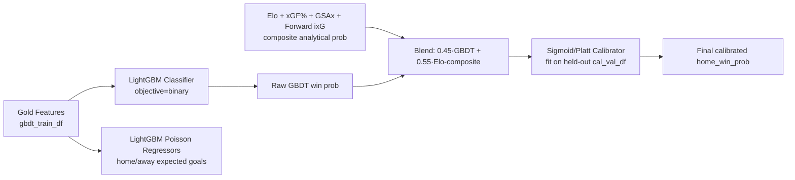

# Stage 1 Model Training & Feature Importance

> **Related Documents**: [System Architecture Blueprint](./architecture.md) | [Data & Feature Specification](./data-and-features.md) | [Phased Implementation Roadmap](./roadmap.md)

This document explains **how the Stage 1 Game Outcome Model is actually trained** (`src/sports_ml/sports/hockey/models/stage1_game.py`), and reports **which input variables currently drive its win-probability predictions the most**, as a reference for prioritizing future feature engineering work.

---

## 1. Training Pipeline Overview

Stage 1 is **not a single model** — it's a 3-part ensemble fit chronologically on `data/gold/hockey/stage1_game_features.parquet`:



### Step-by-step (`Stage1GameOutcomeModel.fit`)
1. **Chronological train/calibration split**: The incoming `train_df` is sorted by `start_time_utc` and split again internally — the first ~80% of unique game timestamps train the GBDT (`gbdt_train_df`), and the most recent ~20% (`cal_val_df`) are held out *strictly after* the GBDT training window to fit the probability calibrator. This prevents the calibrator from ever seeing data the trees were fit on.
2. **Feature selection**: `resolve_feature_columns` picks the ordered subset of `STAGE1_CANDIDATE_FEATURE_COLS` present in the Gold table (51 candidate columns — see §3).
3. **GBDT classifier**: `LGBMClassifier(objective="binary")` with **monotone constraints** (see §4) so, e.g., a higher home Elo rating can never *decrease* the predicted home win probability, regardless of what noisy interactions the trees find.
4. **Auxiliary Poisson goal-pace regressors**: Two more small LightGBM models (`objective="poisson"`) predict expected home/away regulation+OT goals. These aren't used for the win probability itself, but feed Stage 2's game-pace conditioning and the `expected_home_goals`/`expected_away_goals` outputs.
5. **Elo-composite analytical blend**: Before calibration, the raw GBDT probability is blended with a hand-specified analytical formula that converts Elo diff, 5v5 xGF% diff, goalie GSAx diff, and forward ixG diff into an effective Elo gap, then a logistic win probability — weighted **55% analytical / 45% GBDT** (`elo_blend_weight=0.55`). This acts as a strong regularizer against GBDT overfitting on a relatively small (~3,400 game) dataset.
6. **Probability calibration**: A Platt/sigmoid calibrator (`LogisticRegression` on the logit of the blended probability) is fit on `cal_val_df` only, guaranteeing the final probabilities are empirically trustworthy, not just well-ranked.

### Hyperparameters (production defaults)
| Parameter | Value | Purpose |
|---|---|---|
| `n_estimators` | 80 | Small tree count — deliberately conservative for a ~3.4k-row dataset |
| `learning_rate` | 0.04 | Slow learning to reduce overfitting |
| `num_leaves` | 12 (capped further by `height // 3`) | Shallow trees |
| `min_child_samples` | `max(2, min(20, height // 6))` | Scales down automatically on small folds |
| `elo_blend_weight` | 0.55 | Analytical-formula weight vs. GBDT weight (0.45) |
| `calibration_method` | `"sigmoid"` (Platt) | Alternative: `"isotonic"` |
| `monotone_constraints` | see §4 | Enforces directional sanity on ~25 features |

---

## 2. Current Production Feature Importance

Extracted from the live `artifacts/hockey/latest/stage1_model.pkl` LightGBM booster (`importance_type="gain"` — total reduction in training loss attributable to each feature, which is more informative than raw split counts for "how much does this variable matter"):

| Rank | Feature | Gain % | What it measures |
|---|---|---|---|
| 1 | `missing_regular_toi_home` | 7.3% | Minutes of rolling-regular TOI missing from tonight's home lineup (injuries/scratches/call-ups) |
| 2 | `finishing_above_xg_w10_away` | 6.1% | Away team's goals-above-expected over last 10 games (shooting luck/talent signal) |
| 3 | `pdo_5v5_w10_home` | 5.9% | Home team's 5v5 PDO (shooting % + save % — regression-to-mean indicator) |
| 4 | `forward_ixg_per_60_diff` | 5.7% | Home − Away lineup-weighted forward individual expected-goals rate |
| 5 | `pdo_5v5_w10_away` | 5.7% | Away team's 5v5 PDO |
| 6 | `finishing_above_xg_w10_home` | 5.6% | Home team's goals-above-expected over last 10 games |
| 7 | `xgf_pct_5v5_ewma_away` | 4.5% | Away team's EWMA 5v5 expected-goals share (process/territorial quality) |
| 8 | `rest_days_away` | 4.0% | Away team's days of rest |
| 9 | `elo_diff_pre` | 3.9% | Pre-game Elo rating gap (home − away, HFA-adjusted) |
| 10 | `pdo_regression_signal_away` | 3.5% | Away team's PDO deviation from 1.000 (explicit luck-regression flag) |
| 11 | `forward_weighted_ixg_per_60_home` | 3.4% | Home lineup-weighted forward scoring rate |
| 12 | `elo_home_win_prob` | 3.3% | Elo-implied win probability (pre-blend) |
| 13 | `gsax_per_60_shrunk_home` | 3.0% | Home starting goalie's shrunk Goals-Saved-Above-Expected per 60 |
| 14 | `xgf_pct_5v5_ewma_home` | 2.9% | Home team's EWMA 5v5 expected-goals share |
| 15 | `elo_away_pre` | 2.8% | Away team's absolute pre-game Elo rating |
| 16 | `gsax_per_60_shrunk_away` | 2.7% | Away starting goalie's shrunk GSAx/60 |
| 17 | `cf_pct_5v5_w10_diff` | 2.5% | Home − Away 5v5 Corsi (shot attempt) share differential |
| 18–20 | `xga_per_60_5v5_w10_away`, `xgf_pct_5v5_w10_away`, `elo_home_pre` | ~2% each | Shot-suppression rate and absolute ratings |

**Zero-importance features** (never used in a single tree split): `ff_pct_5v5_w10_home`, `hd_xgf_pct_5v5_w10_home`/`_away`, `pp_xgf_per_60_home`, `is_b2b_home`/`_away`, `games_last_4d_away`, `defense_weighted_xgd_per_60_home`/`_away`, `defense_xgd_per_60_diff`. These are either redundant with a correlated feature the trees picked instead, too noisy at current sample size, or genuinely low-signal as computed today.

### Headline takeaways
- **Roster availability (`missing_regular_toi`) is the single strongest signal** — who's actually dressed tonight matters more than any rolling process stat.
- **Luck/regression indicators (PDO, finishing-above-xG) dominate the top 6.** This makes sense for short walk-forward windows: a team that's been running hot/cold on shooting/save % is the most likely to regress toward their process-driven (xG-based) rate in the next game.
- **Elo appears 4 times in the top 20** (`elo_diff_pre`, `elo_home_win_prob`, `elo_away_pre`, `elo_home_pre`) — consistent with the 55% hard-coded blend weight, so some of Elo's "importance" is structurally guaranteed rather than learned.
- **Defense-side features (`defense_weighted_xgd_per_60_*`, `defense_xgd_per_60_diff`) and special-teams features (`pp_xgf_per_60_home`, `hd_xgf_pct_*`) are currently dead weight** — the model isn't extracting signal from them at all.

---

## 3. Full Candidate Feature List

All 51 candidates considered are defined in `STAGE1_CANDIDATE_FEATURE_COLS` ([stage1_game.py](../src/sports_ml/sports/hockey/models/stage1_game.py#L24-L74)) and documented in detail in [§4 of data-and-features.md](./data-and-features.md). They fall into 6 families: **Elo ratings**, **5v5 process/shot-quality** (xGF%, Corsi, Fenwick, High-Danger xGF%, PDO), **special teams** (PP/PK xG rates, net edge), **rest/schedule**, **goalie form** (shrunk GSAx, save %, rest), and **active-roster strength** (lineup-weighted forward/defense ixG, missing TOI).

## 4. Monotone Constraints

To keep the model sane given the small dataset, ~25 of the 51 features have a hard-coded monotonicity direction (e.g., `elo_home_pre ↑ → home_win_prob` can only go up, never down). See `_build_monotone_constraints()` ([stage1_game.py](../src/sports_ml/sports/hockey/models/stage1_game.py#L135-L170)) for the full `pos_cols`/`neg_cols` sets. Unlisted features (mostly the zero-importance ones above) have no constraint.

---

## 5. Ideas to Improve Accuracy

Given the current importance profile, the highest-leverage next steps are likely:

1. **Fix or remove dead features.** `defense_weighted_xgd_per_60_*`/`defense_xgd_per_60_diff` and the High-Danger xGF% features contribute nothing — worth checking whether they're computed correctly (e.g., sign conventions, window size, shrinkage priors) before assuming they're truly uninformative.
2. **Score-effects / game-state adjustment.** Raw 5v5 xGF%/Corsi don't currently account for leading/trailing score state, which systematically biases shot-share stats. A score-adjusted (or "close-score-only") variant of `xgf_pct_5v5` could surface cleaner process signal.
3. **Head-to-head history.** No feature currently captures prior matchup results between the same two teams this season (travel familiarity, rivalry effects, goalie-vs-team history).
4. **Opponent-adjusted rolling stats.** Current rolling xGF%/Corsi windows aren't strength-of-schedule adjusted — a team's rolling stats against weak opponents look the same as against strong ones.
5. **Back-to-back interaction effects.** `is_b2b_home`/`_away` have zero importance individually; an interaction term (e.g., B2B × travel distance, or B2B × goalie rest) may unlock signal a flat boolean can't.
6. **Expand `n_estimators`/`num_leaves` once more seasons of data accumulate.** The current conservative hyperparameters (80 trees, 12 leaves) are explicitly sized for ~3.4k rows; as the dataset grows each season, these should be re-tuned (consider adding an `Optuna`/grid-search step gated on sample size).
7. **Try isotonic calibration** (`calibration_method="isotonic"`) on a larger validation fold now that walk-forward folds are properly sized (see the [evaluate-and-score](../.github/skills/evaluate-and-score/SKILL.md) backtest) — isotonic can capture non-sigmoid miscalibration shapes.
8. **Revisit the fixed 55/45 Elo/GBDT blend weight.** It's currently a hand-tuned constant; cross-validating it (or letting the calibrator learn a per-era weight) could squeeze out additional calibration gains.

---

## 6. Regenerating This Report

Feature importances will drift every time `sports-ml train` is rerun on new data. To regenerate the top-N gain table:

```bash
uv run python -c "
import joblib
m = joblib.load('artifacts/hockey/latest/stage1_model.pkl')
booster = m._classifier.booster_
gains = booster.feature_importance(importance_type='gain')
cols = m.feature_columns
pairs = sorted(zip(cols, gains), key=lambda x: -x[1])
total = sum(gains)
for c, v in pairs:
    print(f'{c:45s} {v:10.1f}  {100*v/total:5.2f}%')
"
```
