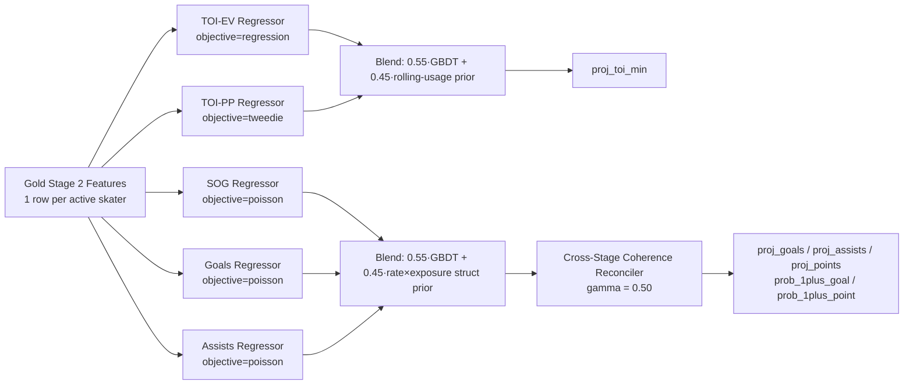

# Stage 2 Model Training & Feature Importance

> **Related Documents**: [Stage 1 Model Training & Feature Importance](./stage1-model-training.md) | [System Architecture Blueprint](./architecture.md) | [Data & Feature Specification](./hockey-data-and-features.md) | [Phased Implementation Roadmap](./roadmap.md)

This document explains **how the Stage 2 Player Matchup Projection pipeline is actually trained** (`src/sports_ml/sports/hockey/models/stage2_player.py`), and reports **which input variables currently drive each skater projection the most**, as a reference for prioritizing future feature engineering work.

---

## 1. Training Pipeline Overview

Stage 2 is **5 independent LightGBM regressors** (no single unified model), each blended with a hand-specified structural prior, then passed through a cross-stage coherence reconciler so team-level totals stay consistent with Stage 1:



A separate, non-learned (`predict_goalies`) formula produces goalie projections from team-level signals — see §5.

### Step-by-step (`Stage2PlayerProjectionModel.fit` / `.predict`)
1. **Feature selection**: `resolve_feature_columns` picks the ordered subset of `STAGE2_SKATER_FEATURE_COLS` present in the Gold table (22 candidate columns — see §3). Unlike Stage 1, there is **no walk-forward chronological split inside `fit()`** — the caller (`sports-ml train`) supplies the full training window directly; `fit()` trains all 5 regressors in one pass.
2. **Five independent GBDT regressors** are fit on the same feature matrix but different targets:
   - `_toi_ev_model` (plain regression) → even-strength TOI minutes
   - `_toi_pp_model` (Tweedie, or plain regression if no team has PP TOI in-sample) → power-play TOI minutes
   - `_sog_model` (Poisson) → shots on goal, with monotone constraints
   - `_goals_model` (Poisson) → goals, with monotone constraints
   - `_assists_model` (Poisson) → assists, with monotone constraints
3. **Monotone constraints** (scoring models only — `_sog_model`, `_goals_model`, `_assists_model`): rolling per-60 production rates and `opp_xga_per_60_5v5` are constrained positive; `opp_goalie_gsax_per_60_shrunk` is constrained negative (a hotter opposing goalie can only suppress projected output, never boost it).
4. **GBDT/structural-prior blend (`gbdt_blend_weight=0.55`)**: Every raw GBDT prediction is blended **55% GBDT / 45% hand-specified structural prior** at inference time:
   - **TOI prior**: `rolling_toi_ev_min`/`rolling_toi_pp_min` bumped by vacated-TOI from injured teammates (`+0.08×vacated` for EV, `+0.02×vacated` for PP).
   - **SOG/Goals/Assists prior**: `rolling_rate_per_60 × (proj_TOI / 60)`, scaled by three environment modifiers:
     - `pace_env_mod = stage1_expected_team_goals / 3.05` (league-average pace anchor) — applied to SOG only, via `sqrt()`.
     - `def_env_mod = opp_xga_per_60_5v5 / 2.55`, clipped to `[0.65, 1.45]` — applied to goals/assists.
     - `goalie_env_mod = exp(-0.12 × opp_goalie_gsax_per_60_shrunk)` — applied to both the GBDT and structural goals/assists outputs, suppressing production against hot goalies.
5. **Cross-stage coherence reconciliation (`reconcile_skater_team_goals`, γ=0.50)**: Raw per-skater goal/assist projections are summed per `(game_id, team)` and rescaled by `(stage1_expected_team_goals / raw_team_sum) ** gamma` so the roster's total projected scoring stays anchored to Stage 1's team-goals estimate, while preserving each skater's *relative* share. `prob_1plus_goal`/`prob_1plus_point` are then derived from the reconciled Poisson means: $1 - e^{-\mu}$.

### Hyperparameters (production defaults)
| Parameter | Value | Purpose |
|---|---|---|
| `n_estimators` | 60 | Small tree count per sub-model |
| `learning_rate` | 0.05 | Slow learning to reduce overfitting |
| `num_leaves` | 15 (capped further by `height // 4`) | Shallow trees |
| `min_child_samples` | `max(2, min(20, height // 6))` | Scales down automatically on small folds |
| `gbdt_blend_weight` | 0.55 | GBDT weight vs. structural-prior weight (0.45) |
| `reconciliation_gamma` | 0.50 | Damping factor for team-goals coherence scaling |
| `assist_share_per_goal` | 1.68 | League-average assists-per-goal used to set the team assist-total target |

---

## 2. Current Production Feature Importance

Extracted from the live `artifacts/hockey/latest/stage2_model.pkl` — each of the 5 sub-models has its own gain-based importance ranking (`importance_type="gain"`):

### TOI-EV model (even-strength ice time)
| Rank | Feature | Gain % |
|---|---|---|
| 1 | `rolling_shifts_per_game` | 69.1% |
| 2 | `rolling_toi_total_min` | 15.2% |
| 3 | `rolling_toi_ev_min` | 11.7% |
| 4 | `rolling_toi_pp_min` | 1.6% |

Dominated almost entirely by recent usage (shift count), as expected — a player's own role is the best predictor of their own ice time.

### TOI-PP model (power-play ice time)
| Rank | Feature | Gain % |
|---|---|---|
| 1 | `rolling_points_per_60` | 27.9% |
| 2 | `rolling_shifts_per_game` | 23.7% |
| 3 | `rolling_sog_per_60` | 7.3% |
| 4 | `rolling_toi_ev_min` | 7.0% |
| 5 | `rolling_ixg_per_60` | 6.7% |

PP time is driven more by offensive production rate than raw usage — consistent with how PP units are selected (skill-based, not role-based).

### SOG model (shots on goal)
| Rank | Feature | Gain % |
|---|---|---|
| 1 | `rolling_sog_per_60` | 42.0% |
| 2 | `rolling_shifts_per_game` | 31.2% |
| 3 | `rolling_toi_total_min` | 8.3% |
| 4 | `rolling_points_per_60` | 5.8% |
| 5 | `rolling_ixg_per_60` | 5.4% |

### Goals model
| Rank | Feature | Gain % |
|---|---|---|
| 1 | `rolling_points_per_60` | 40.2% |
| 2 | `rolling_shifts_per_game` | 13.5% |
| 3 | `rolling_ixg_per_60` | 11.9% |
| 4 | `rolling_toi_ev_min` | 9.7% |
| 5 | `rolling_sog_per_60` | 7.6% |
| 6 | `stage1_expected_team_goals` | 7.5% |

### Assists model
| Rank | Feature | Gain % |
|---|---|---|
| 1 | `rolling_shifts_per_game` | 49.8% |
| 2 | `stage1_expected_team_goals` | 13.8% |
| 3 | `rolling_assists_per_60` | 9.3% |
| 4 | `rolling_points_per_60` | 6.9% |
| 5 | `rolling_sog_per_60` | 4.7% |

### Headline takeaways
- **Usage dominates every single model.** `rolling_shifts_per_game` is a top-2 feature in all 5 sub-models, and `rolling_toi_*` features consistently rank in the top 5. Stage 2's accuracy is bottlenecked more by "how much will this player play tonight" than by any matchup/opponent signal.
- **Opponent/matchup context is almost entirely ignored by the GBDTs.** `opp_xga_per_60_5v5`, `opp_sa_per_60_5v5`, `opp_pk_xga_per_60`, `opp_penalties_taken_per_60`, and `opp_goalie_gsax_per_60_shrunk` don't appear in any top-8 list — all of that matchup adjustment work is currently done by the **hand-coded structural prior** (`def_env_mod`, `goalie_env_mod`) at inference time, not learned by the trees.
- **`stage1_expected_team_goals` meaningfully informs goals (7.5%) and assists (13.8%)**, confirming the Stage 1→Stage 2 conditioning pathway is working — a team projected to score more produces proportionally higher individual projections, reinforced further by the γ=0.50 coherence reconciler.
- **`career_shooting_pct_shrunk` and `team_injury_vacated_toi_f_or_d`** barely register in any top-8 — the injury-vacated-TOI signal is currently leaned on more through the structural prior's additive TOI bump (`+0.08×vacated`) than through the GBDT itself.

---

## 3. Full Candidate Feature List

All 22 candidates are defined in `STAGE2_SKATER_FEATURE_COLS` ([stage2_player.py](../src/sports_ml/sports/hockey/models/stage2_player.py#L21-L43)) and documented in detail in [§5.1 of hockey-data-and-features.md](./hockey-data-and-features.md). They fall into 4 families: **individual rolling usage** (TOI, shifts, vacated-teammate TOI), **individual rolling per-60 production** (SOG, ixG, goals, assists, points, shrunk career shooting%), **opponent/goalie matchup context** (opponent xGA/SA/PK rates, opponent GSAx), and **Stage 1 macro conditioning** (team win probability, expected team goals, home/rest/B2B context).

## 4. Monotone Constraints

Only the 3 scoring-rate models (`_sog_model`, `_goals_model`, `_assists_model`) apply monotone constraints — `_toi_ev_model`/`_toi_pp_model` are unconstrained. See `_build_monotone_constraints()` ([stage2_player.py](../src/sports_ml/sports/hockey/models/stage2_player.py#L176-L198)): rolling production rates and `opp_xga_per_60_5v5` are forced positive; `opp_goalie_gsax_per_60_shrunk` is forced negative.

## 5. Goalie Projections (Non-Learned)

Unlike skaters, goalie projections (`predict_goalies`) are **pure formula, no GBDT**:
- `proj_shots_against`: anchored to the sum of the opposing skaters' `proj_sog` (falls back to league-average `29.5` if unavailable).
- `proj_goals_against`: a 60/40 blend of a Stage-1-anchored estimate (`opponent's expected_goals`, GSAx-adjusted) and a save%-derived estimate (`shots_against × (1 - save_pct) - 0.5×gsax`).
- `proj_saves` / `proj_save_pct`: derived arithmetically from the above, capped so goals against never exceeds shots against.

Because there's no learned model here, there's no feature importance to report — but it's the most direct place to add a real GBDT regressor if goalie projection accuracy becomes a priority.

---

## 6. Ideas to Improve Accuracy (Stage 2 MAE: currently 0.56 points/skater)

1. **Let the GBDT learn matchup adjustments instead of hard-coding them.** Since `opp_*` columns are in the feature set but never get picked by the trees, investigate why — likely too weak a signal relative to usage features at current tree depth/leaf counts, or the structural-prior blend (`gbdt_blend_weight=0.55`) is diluting incentive to use them. Consider training a quantile/SHAP check, or temporarily removing usage features to force opponent signal to surface.
2. **Separate forwards and defensemen into different models.** All skaters currently share one feature set and model family; defensemen have structurally different scoring rates (assists-heavy, far fewer goals) — position-specific models could substantially cut MAE.
3. **Add line/pairing combination features.** Projected linemates (especially who's on a player's PP unit) aren't modeled — two players with identical rolling rates can have very different actual outputs depending on tonight's linemates.
4. **Validate the hard-coded blend/reconciliation constants (`gbdt_blend_weight=0.55`, `reconciliation_gamma=0.50`, `assist_share_per_goal=1.68`).** These are currently fixed, not learned or cross-validated — a grid search against Stage 2 MAE on a proper walk-forward split (mirroring the Stage 1 fix in [stage1-model-training.md](./stage1-model-training.md)) could tune them empirically.
5. **Build a real goalie GBDT.** §5's formula-only approach ignores most of the matchup feature set (`opp_penalties_taken_per_60`, team rest/B2B) entirely for goalies — a learned model analogous to the skater regressors would likely beat the current heuristic.
6. **Add a proper held-out evaluation path.** `fit()` currently has no internal train/validation split (unlike Stage 1's chronological calibration split) — Stage 2 MAE is only ever measured via the full `sports-ml backtest --stage all` walk-forward harness, so there's no quick in-training diagnostic for overfitting on these 5 sub-models.

---

## 7. Regenerating This Report

Feature importances will drift every time `sports-ml train --include-stage2` is rerun on new data. To regenerate all 5 sub-model gain tables:

```bash
uv run python -c "
import joblib
m = joblib.load('artifacts/hockey/latest/stage2_model.pkl')
cols = m.feature_columns
for name, model in [('toi_ev', m._toi_ev_model), ('toi_pp', m._toi_pp_model), ('sog', m._sog_model), ('goals', m._goals_model), ('assists', m._assists_model)]:
    gains = model.booster_.feature_importance(importance_type='gain')
    total = sum(gains) or 1
    pairs = sorted(zip(cols, gains), key=lambda x: -x[1])
    print(f'--- {name} model (objective={model.objective}) ---')
    for c, v in pairs:
        print(f'  {c:35s} {v:10.1f}  {100*v/total:5.2f}%')
"
```
